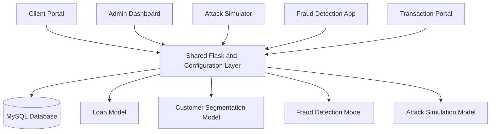

# CBSS — Core Banking Software System

CBSS is a modular, Python-based banking management project that brings together customer and employee management, transaction workflows, loan evaluation, customer segmentation, and fraud-detection demonstrations.

The project is built with Flask and MySQL, with selected machine-learning workflows implemented using scikit-learn. It is intended for academic and learning purposes.

> **Security notice:** CBSS is a demonstration project, not production banking software. Do not use it to process real financial transactions or store real customer data. Demo credentials, authentication flows, and security controls must not be treated as production-ready.

## Features

- **Customer management:** View, add, edit, search, and manage customer records.
- **Employee management:** Administrative employee record management.
- **Transaction workflows:** Client transaction creation and transaction history.
- **Loan evaluation:** Decision Tree-based loan prediction workflow.
- **Customer segmentation:** KMeans clustering to group customers.
- **Fraud detection:** Model-assisted transaction review using sample transaction data.
- **Attack simulation:** A separate demonstration interface for exploring suspicious or simulated activity.
- **Service management:** Scripts to start, stop, and check the health of the Flask applications.
- **Testing:** Unit and integration test suites.

## Architecture

CBSS is organised into five Flask applications supported by shared infrastructure and model services.



### Repository structure

```text
CBSS-Banking-software/
├── apps/                 # Five Flask application entry points
├── shared/               # Configuration, database, logging and security utilities
├── services/             # Machine-learning model services
├── templates/            # Jinja2 templates grouped by application
├── static/               # Frontend assets and shared JavaScript
├── scripts/              # Startup, shutdown, health-check and seed scripts
├── tests/
│   ├── unit/
│   └── integration/
├── data/
│   ├── schema.sql        # MySQL schema
│   └── demo_transactions.csv
├── legacy/               # Earlier project implementation
├── .env.example          # Safe configuration template
├── .gitignore
├── requirements.txt
└── README.md
```

## Applications

| Port | Application | Purpose |
|---:|---|---|
| 5000 | Admin Dashboard | Customer, employee, loan, segmentation and transaction administration |
| 5001 | Client Portal | Client login, dashboard and transaction workflows |
| 5002 | Attack Simulator | Demonstration of simulated attack activity |
| 5003 | Fraud Detection | Fraud detection and review interface |
| 5004 | Simple Transaction Portal | Separate transaction workflow demonstration |

The local URLs exposed by the applications include:

- Admin dashboard: http://localhost:5000/admin
- Client login: http://localhost:5001/login
- Attack simulator: http://localhost:5002/
- Fraud detection: http://localhost:5003/hacker
- Transaction portal: http://localhost:5004/login

## Machine-learning components

| Component | Algorithm | Data source |
|---|---|---|
| Loan evaluation | Decision Tree | Customer records in the database |
| Customer segmentation | KMeans clustering (4 clusters) | Customer records in the database |
| Fraud detection | Decision Tree | Sample transaction dataset |
| Attack simulation | Decision Tree | Sample transaction dataset |

These models are project demonstrations. Their predictions are not validated for real credit decisions, financial fraud prevention, or security operations.

## Tech Stack

- **Backend:** Python, Flask
- **Database:** MySQL
- **Data processing:** Pandas
- **Machine learning:** scikit-learn
- **Frontend:** HTML, CSS, JavaScript, Jinja2
- **Configuration:** python-dotenv
- **Testing:** pytest

## Getting Started

### Prerequisites

- Python 3.12 or later
- MySQL Server
- Git

### 1. Clone the repository

```bash
git clone https://github.com/rohan-K210/CBSS-Banking-software.git
cd CBSS-Banking-software
```

### 2. Create and activate a virtual environment

**Windows (PowerShell):**

```powershell
python -m venv .venv
.\.venv\Scripts\Activate.ps1
```

**macOS / Linux:**

```bash
python3 -m venv .venv
source .venv/bin/activate
```

### 3. Install dependencies

```bash
python -m pip install --upgrade pip
pip install -r requirements.txt
```

### 4. Create the database

Create a MySQL database using the provided schema:

```bash
mysql -u root -p < data/schema.sql
```

Make sure the MySQL server is running and that the database user has the required permissions.

### 5. Configure environment variables

Copy the example configuration file:

**Windows (PowerShell):**

```powershell
Copy-Item .env.example .env
```

**macOS / Linux:**

```bash
cp .env.example .env
```

Edit `.env` and set your local database credentials and a unique random `SECRET_KEY`. Keep the real `.env` file private; it is excluded from version control. Never commit passwords, API keys, or production secrets.

### 6. Seed sample data

```bash
python scripts/seed_data.py
```

### 7. Start all applications

```bash
python scripts/start_all.py
```

The process manager starts the five Flask applications on their configured ports and performs health checks. Use `Ctrl+C` to stop the processes.

## Demo Login Information

The repository's sample setup documents the following demonstration access:

| Portal | Demo access |
|---|---|
| Client Portal | Customer IDs 1–5; sample password: `password123` |
| Admin Dashboard | No login required in the current demo flow |

These values are public test credentials, not secure account credentials. Do not reuse them for any real account. The admin interface's lack of a login requirement is a known limitation and must be addressed before any deployment beyond a local demonstration.

## Useful Commands

```bash
# Start all applications
python scripts/start_all.py

# Start without startup health checks
python scripts/start_all.py --no-health-check

# Stop all applications
python scripts/stop_all.py

# Check service health
python scripts/health_check.py

# Seed sample data
python scripts/seed_data.py

# Run tests
PYTHONPATH=. python -m pytest tests/ -v
```

## Configuration Reference

The `.env.example` file documents the available settings:

| Variable | Purpose |
|---|---|
| `DB_HOST`, `DB_PORT` | MySQL host and port |
| `DB_USER`, `DB_PASSWORD`, `DB_NAME` | Database connection |
| `DB_POOL_SIZE` | Database connection pool size |
| `SECRET_KEY` | Flask session signing key |
| `DEBUG`, `LOG_LEVEL` | Debugging and logging configuration |
| `ADMIN_PORT`, `CLIENT_PORT` | Admin and client application ports |
| `HACKER_PORT`, `FRAUD_DETECTOR_PORT` | Simulator and fraud application ports |
| `SIMPLE_TRANSACTION_PORT` | Transaction portal port |

Use the example file as a template and supply your own local values.

## Testing

Run the test suite from the repository root:

```bash
PYTHONPATH=. python -m pytest tests/ -v
```

The tests are organised into unit and integration test groups.

## Limitations and Future Work

- Add authentication and role-based access control to every administrative and service interface.
- Replace demonstration credentials with secure password hashing and account-management flows.
- Add stronger request validation, CSRF protection, and security-focused tests.
- Improve model evaluation with documented datasets, metrics, and validation procedures.
- Remove generated Python bytecode and other build artefacts from version control.
- Expand automated tests for transaction, fraud-review, and model workflows.

---

*Built as an academic project exploring Flask application structure, database-backed workflows, and introductory machine-learning integration.*
